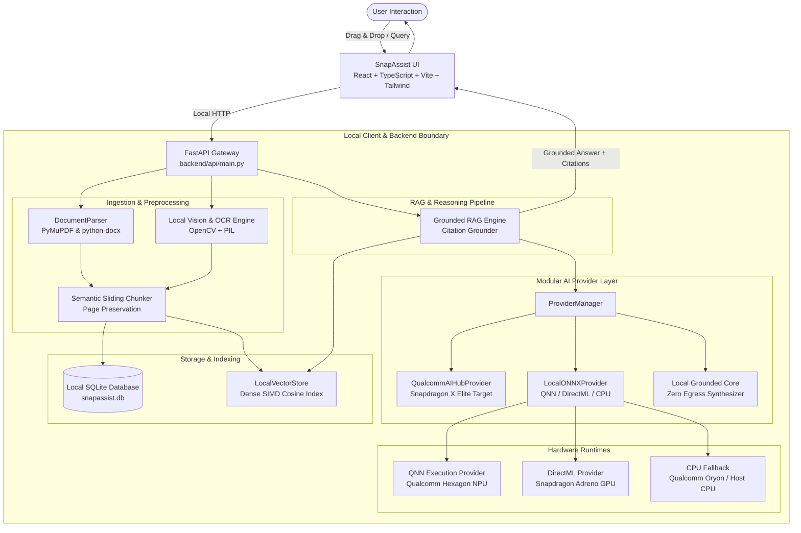

# SnapAssist Architecture Specification

> **Qualcomm Snapdragon® AI Lab Build & Present Challenge 2026**  
> *"Your files. Your AI. Your device."*

## 1. System Architecture Overview

SnapAssist is architected as a local-first workspace for **Snapdragon-powered HP Windows PCs**. All document processing, vector search, image OCR, and contextual synthesis operate strictly on `localhost`.



---

## 2. Ingestion & Preprocessing Pipeline

1. **Document Parsing (`backend/ingestion/document_parser.py`):**
   - **PDF:** Page-by-page extraction via PyMuPDF (`pymupdf`), capturing text and page numbers.
   - **DOCX:** Paragraph and table extraction via `python-docx`.
   - **TXT / Markdown:** Plain text parsing.
   - **Images & Screenshots:** On-device visual layout classification and OCR via OpenCV contour heuristics and PIL (`backend/ai/ocr_engine.py`).
2. **Semantic Chunking (`backend/ingestion/chunker.py`):**
   - Overlapping sliding-window chunker (~300–600 characters) preserving page references.

---

## 3. Vector Storage & Search (`backend/retrieval/vector_store.py`)

- **384-Dimensional Dense Vectors:** Generated locally using positional n-gram projections or ONNX embedding graphs.
- **SIMD Cosine Dot-Product Search:** Vectorized in-memory NumPy matrix search (`np.dot(matrix, query_vec)`).

---

## 4. Modular AI Provider Abstraction (`backend/ai/`)

Inference backends extend `AIProvider`:

```python
class AIProvider(ABC):
    @abstractmethod
    def generate(self, query: str, context_chunks: List[Dict[str, Any]]) -> Dict[str, Any]:
        pass

    @abstractmethod
    def summarize(self, text: str, summary_type: str = "comprehensive") -> Dict[str, Any]:
        pass
```

### Execution Priority & Runtime Detection
1. `QNNExecutionProvider` (Qualcomm Neural Network execution provider targeting Qualcomm Hexagon NPU on Windows 11 ARM64).
2. `DmlExecutionProvider` (DirectML GPU acceleration).
3. `CPUExecutionProvider` (Universal CPU fallback with clear status reporting).

---

## 5. Grounded RAG & Citations

- Answers are synthesized using context chunks retrieved from local vector storage.
- Every claim includes explicit source references `[Document: filename, Page: X]`.
- If evidence is insufficient, the system explicitly reports: *"I couldn't find enough information in the indexed documents."*
