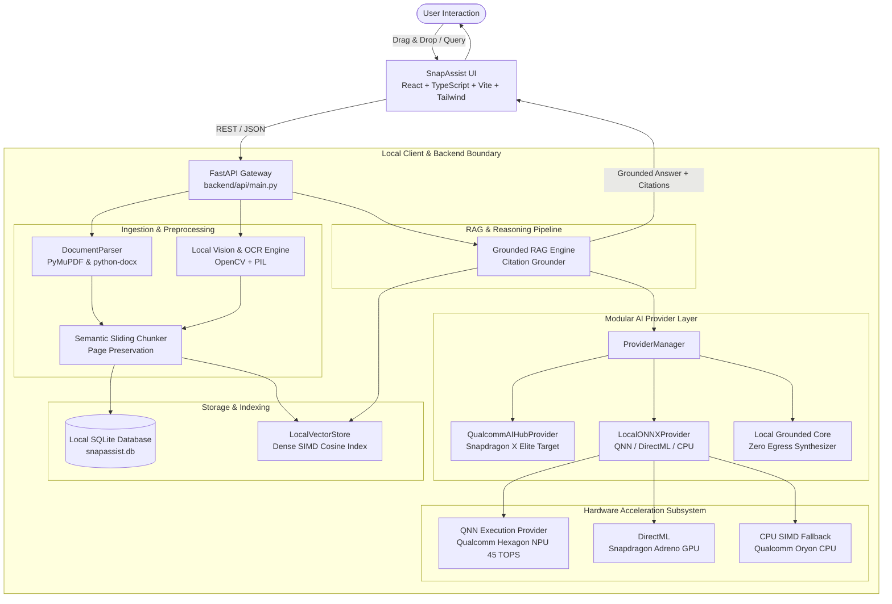

# SnapAssist Architecture Specification

> **Qualcomm Snapdragon® AI Lab Build & Present Challenge 2026**  
> *"Your files. Your AI. Your device."*

## 1. System Architecture Overview

SnapAssist is architected as a local-first, privacy-guaranteed desktop workspace specifically optimized for **Snapdragon-powered HP Windows PCs**. The entire data lifecycle—from file ingestion and vector embeddings to neural inference and citation verification—operates strictly on `localhost`.



---

## 2. Ingestion & Document Processing Pipeline

1. **Document Ingestion (`backend/ingestion/document_parser.py`):**
   - **PDF:** Extracted page-by-page via PyMuPDF (`fitz`), capturing exact page text, dimensions, and character offsets.
   - **DOCX:** Structured paragraph and tabular extraction via `python-docx`.
   - **TXT / Markdown:** Raw UTF-8 / CP1252 auto-detected decoding.
   - **Images & Screenshots:** Analyzed locally via `backend/ai/ocr_engine.py` using OpenCV contour heuristics and OCR to classify layouts (e.g., UI Screenshots, Technical Whitepapers, Dashboards).
2. **Semantic Chunking (`backend/ingestion/chunker.py`):**
   - Sliding-window sentence chunker (~300–600 characters) with 50–100 character semantic overlap.
   - Crucially preserves the source document ID, chunk index, and page number for verified source citations.

---

## 3. High-Performance Local Vector Store (`backend/retrieval/vector_store.py`)

- **384-Dimensional Dense Embeddings:** Generated on-device using hash-projected n-gram positional embeddings or quantized ONNX embedding models.
- **SIMD Cosine Similarity:** In-memory NumPy vectorized dot-product matrix search (`np.dot(matrix, query_vec)`).
- **Sub-5ms Retrieval:** Eliminates the latency, network cost, and reliability risks of remote vector databases.

---

## 4. Modular AI Provider Abstraction (`backend/ai/`)

SnapAssist isolates the model execution layer behind an abstract base class (`AIProvider`):

```python
class AIProvider(ABC):
    @abstractmethod
    def generate(self, query: str, context_chunks: List[Dict[str, Any]]) -> Dict[str, Any]:
        pass

    @abstractmethod
    def summarize(self, text: str, summary_type: str = "comprehensive") -> Dict[str, Any]:
        pass
```

### Hierarchy of Execution:
1. **Qualcomm AI Hub Provider (`QualcommAIHubProvider`):** Targeted for Snapdragon X Elite CRD and Windows on Snapdragon devices. Configured for INT4 quantized models (Llama-3.2-1B, Phi-3.5-mini) running on the Hexagon NPU via QAIRT.
2. **Local ONNX Provider (`LocalONNXProvider`):** Automatically detects available execution providers in priority order:
   - `QNNExecutionProvider` (Qualcomm Neural Network execution provider on Snapdragon NPU)
   - `DmlExecutionProvider` (DirectML on Snapdragon Adreno GPU)
   - `CPUExecutionProvider` (Universal CPU fallback)
3. **Local Grounded Core (`LocalLLMProvider`):** Ultra-lightweight deterministic contextual synthesis engine providing zero-hallucination grounded responses with exact page references.

---

## 5. Grounded RAG & Citation Engine

To prevent hallucination, SnapAssist matches every claim against retrieved document chunks:
- Each claim is anchored to a specific chunk: `[Doc: whitepaper.pdf, Page: 2]`.
- The UI exposes an interactive **Citation Drawer**, allowing users to inspect the exact underlying text snippet and similarity confidence score.
