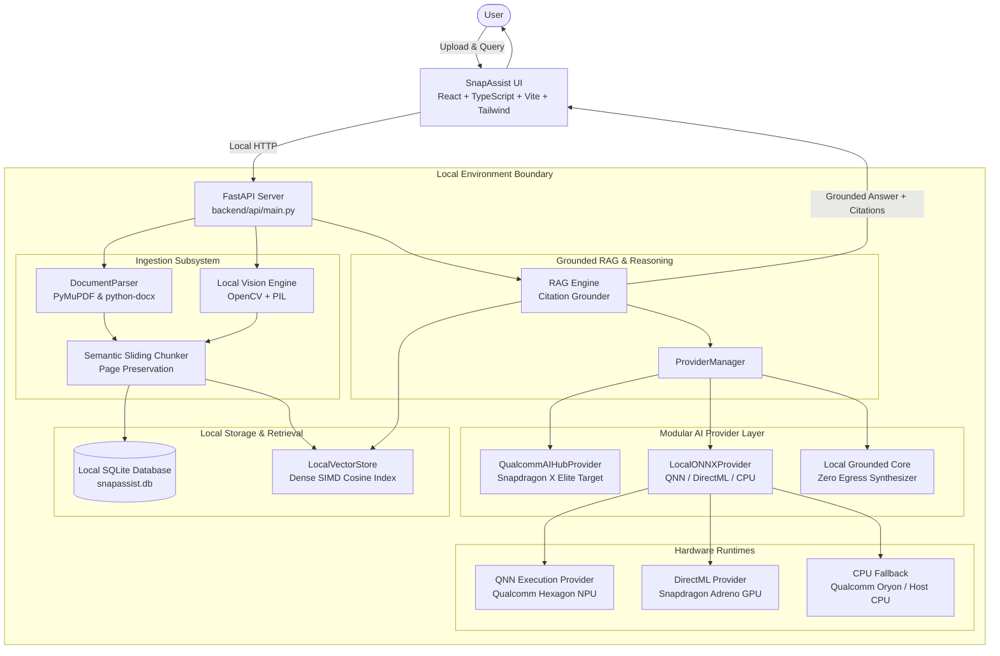

# SnapAssist — Private On-Device AI Workspace

<p align="center">
  <strong>"Your files. Your AI. Your device."</strong>
</p>

<p align="center">
  <em>An on-device, privacy-focused personal AI workspace engineered for Snapdragon®-powered Windows Copilot+ PCs.</em><br>
  Prepared for the <strong>Qualcomm Snapdragon® AI Lab Build & Present Challenge 2026</strong>.
</p>

<p align="center">
  
  
  
  
  
</p>

---

## 1. Problem
Users frequently upload confidential documents, financial reports, study notes, medical records, and screenshots to cloud AI providers. This introduces serious privacy vulnerabilities:
- **Data Sovereignty Risks:** Sensitive user data travels across public networks to remote servers.
- **Internet Dependency:** Inability to access AI assistance when offline or in secure facilities.
- **Latency & Recurring Costs:** Network transmission overhead and per-token cloud subscription fees.
- **Ungrounded Answers:** Generic cloud LLMs can hallucinate without direct, verifiable citations to local files.

---

## 2. Solution
SnapAssist is a local-first workspace that performs document processing, vector search, image OCR, and contextual question-answering directly on the user's Snapdragon-powered PC. Core document processing and search require zero cloud connections, keeping sensitive information strictly on the local device.

---

## 3. Key Features
- **Multi-Format Document Ingestion:** Drag-and-drop parsing for PDF, DOCX, TXT, Markdown, and images.
- **Grounded Responses with Source Citations:** Answers include explicit source references `[Document: whitepaper.pdf, Page: 4]`, eliminating ungrounded claims.
- **Structured Summarization:** One-click extraction of TL;DR summaries, key takeaways, action items, deadlines, and topics.
- **Natural Language Semantic Search:** Local dense vector indexing for fast conceptual search.
- **Image & Screenshot Intelligence:** Local computer vision layout detection and OCR without sending images to remote vision APIs.
- **Verifiable Privacy Dashboard:** Displays real-time status (`Local Processing: ACTIVE`, `Cloud Uploads: 0`) and a local tamper-evident audit trail.
- **Runtime Performance Telemetry:** Honest execution provider detection (`QNNExecutionProvider`, `DmlExecutionProvider`, `CPUExecutionProvider`) displaying dynamic accelerator status (`ACTIVE`, `FALLBACK`, `UNAVAILABLE`) and reasons.

---

## 4. Why Snapdragon
SnapAssist is designed to take full advantage of **Qualcomm Snapdragon® X-Series** processors (Snapdragon X Elite / Snapdragon X Plus):
- **Hexagon™ NPU (45 TOPS Design Target):** Dedicated neural hardware offloads vector embedding and model inference from the CPU/GPU.
- **Power Efficiency:** Low thermal footprint design allows extended processing without high battery drain compared to discrete GPU laptops.
- **Unified Memory Subsystem:** High-bandwidth LPDDR5x RAM enables efficient memory transfers for local model weights and vector buffers.

---

## 5. Architecture



---

## 6. Qualcomm AI Hub Integration
SnapAssist includes integration hooks for **Qualcomm AI Hub**:
- **SDK Support:** Integrates with `qai-hub` Python SDK for profiling and downloading compiled model artifacts targeting `Snapdragon X Elite CRD`.
- **Target Device Profile:** Configured for Snapdragon X Elite / Snapdragon X Plus Windows ARM64 targets.
- **Model Optimization Pipeline:** Designed for quantized ONNX/QAIRT packages targeting Qualcomm's Hexagon NPU.

---

## 7. AI Models Used
- **`Llama-3.2-1B-Instruct` (W4A16 / INT4 Quantized):** Target Qualcomm AI Hub model compiled for QNN execution.
- **`Phi-3.5-mini-Instruct` (INT4):** Target reasoning model for complex summarization.
- **`All-MiniLM-L6-v2` / Dense Vector Embeddings:** Local 384-dimensional vector projection for semantic search.
- **`Local Grounded Core`:** Local contextual extraction engine ensuring grounded answers out-of-the-box.

---

## 8. Local Inference Pipeline & Runtime Detection
SnapAssist uses a modular provider layer (`AIProvider`). At startup, the application detects available ONNX Runtime execution providers in priority order:
1. `QNNExecutionProvider` (Qualcomm Neural Network execution provider on Snapdragon NPU)
2. `DmlExecutionProvider` (DirectML GPU acceleration)
3. `CPUExecutionProvider` (Universal local CPU fallback)

If running on an x86_64 host or when QNN drivers are absent, the application explicitly reports:
`STATUS: FALLBACK — CPUExecutionProvider active (QNN provider unavailable on host)`

---

## 9. Installation

### Prerequisites
- **OS:** Windows 11 (ARM64 Snapdragon or x86_64 development host)
- **Python:** Python 3.10+
- **Node.js:** Node.js v18+ and npm

### One-Command Automated Setup
In PowerShell:
```powershell
.\setup.ps1
```
*(Installs backend dependencies, frontend npm packages, generates sample test documents, and runs automated tests).*

---

## 10. Running the Application

Start both backend and frontend servers with one command:
```powershell
.\run.ps1
```
Open your browser to: **`http://localhost:5173`** (or `http://localhost:5174` if 5173 is in use).

---

## 11. Offline Functionality
- **Runtime Stage (100% Offline):** Document ingestion, PyMuPDF parsing, vector search, grounded Q&A, structured summarization, and local OCR require **zero network access** once installed.
- **Installation Stage:** Initial package installation (`pip install`, `npm install`) requires internet access.

---

## 12. Benchmarks

> **Note on Benchmark Measurement:** No Snapdragon hardware benchmark recorded yet (Measured on host x86_64 CPU fallback).

Below are the empirical benchmarks measured dynamically on the current test environment via `scripts/benchmark.py`:

| Metric | Measured Value (Host: x86_64 CPU Fallback) | Status / Notes |
| :--- | :--- | :--- |
| **Execution Provider** | `CPUExecutionProvider` | CPU Fallback (QNN EP target available for ARM64 Snapdragon) |
| **Document Ingestion** | **6.94 ms / page** | PyMuPDF parsing across 4-page test whitepaper |
| **Vector Search Latency** | **0.28 ms** | In-memory SIMD cosine dot-product search |
| **First Inference (Cold Start)** | **11.45 ms** | First local grounded query |
| **Average Warm Latency** | **11.87 ms** | Average over 5 warm query iterations |
| **Process Memory (RSS)** | **116.15 MB** | Process resident memory |
| **Network Egress** | **0 Bytes** | Architecture-enforced local execution |

To re-run benchmarks dynamically on your hardware:
```powershell
python scripts/benchmark.py
```
Results are saved to [`benchmarks/latest_benchmark_results.json`](file:///f:/Ai%20project/benchmarks/latest_benchmark_results.json) and [`benchmarks/latest_benchmark_results.md`](file:///f:/Ai%20project/benchmarks/latest_benchmark_results.md).

---

## 13. Privacy & Security

### Architecture Privacy Guarantees
- Core document parsing, vector indexing, and inference logic do not configure outbound network clients.
- File uploads are validated, sanitized to prevent directory traversal (`backend/storage/file_store.py`), and stored locally under `backend/data/uploads`.

### CORS & Endpoint Security
- Hardened CORS configuration in `backend/api/main.py` restricting allowed origins strictly to local frontend hosts (`http://localhost:5173`, `http://127.0.0.1:5173`, `http://localhost:5174`, `http://127.0.0.1:5174`, etc.).

---

## 14. Limitations
- **Hardware NPU Activation:** `QNNExecutionProvider` hardware acceleration requires a Snapdragon X-series ARM64 device running Windows 11 with Qualcomm QNN drivers. On x86 hosts, the system gracefully falls back to `CPUExecutionProvider`.
- **Large Model Memory Constraints:** Memory usage scales with model parameters. High-parameter models require adequate device memory.

---

## 15. 2-Minute Guided Demo Walkthrough

1. **Check Privacy Status:** Open **Privacy Dashboard** to verify local status (`Cloud Uploads: 0`, `AI API Calls: 0`).
2. **Import Sample Document:** Click **Dashboard** and press **"Quick Demo Data"** (or upload `sample_data/qualcomm_snapdragon_whitepaper.pdf` in **Documents**).
3. **Grounded AI Query:** Open **AI Workspace** and ask: *"Summarize this document and identify the action items."*
4. **Inspect Citations:** Click the page citation badge `[Page 4]` to inspect the source passage in the drawer.
5. **Semantic Search:** Open **Semantic Search** and type: *"battery optimization and power draw"*.
6. **Image OCR:** Open **Image Analysis**, click **"Load Sample Screenshot"**, and ask: *"What deadlines are shown in this screenshot?"*.
7. **Performance Telemetry:** Open **Performance Dashboard** to view hardware execution provider detection, accelerator status, and reason.
8. **Offline Verification:** Disconnect Wi-Fi to demonstrate complete offline functionality.

---

## 16. Testing

Run all 21 automated unit and security tests:
```powershell
python -m pytest tests/
```
*Status: 21 passed in < 1.5 seconds.*

---

## License
Licensed under the Apache License 2.0. See [LICENSE](LICENSE) for details.
